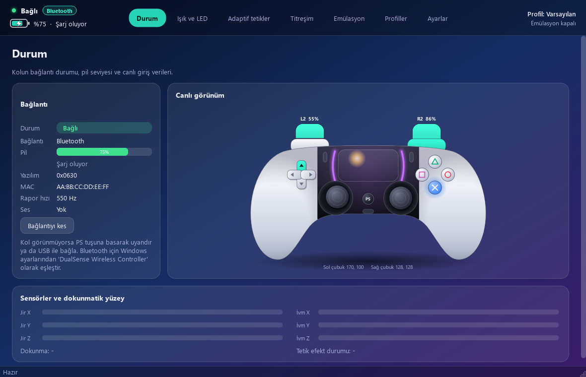
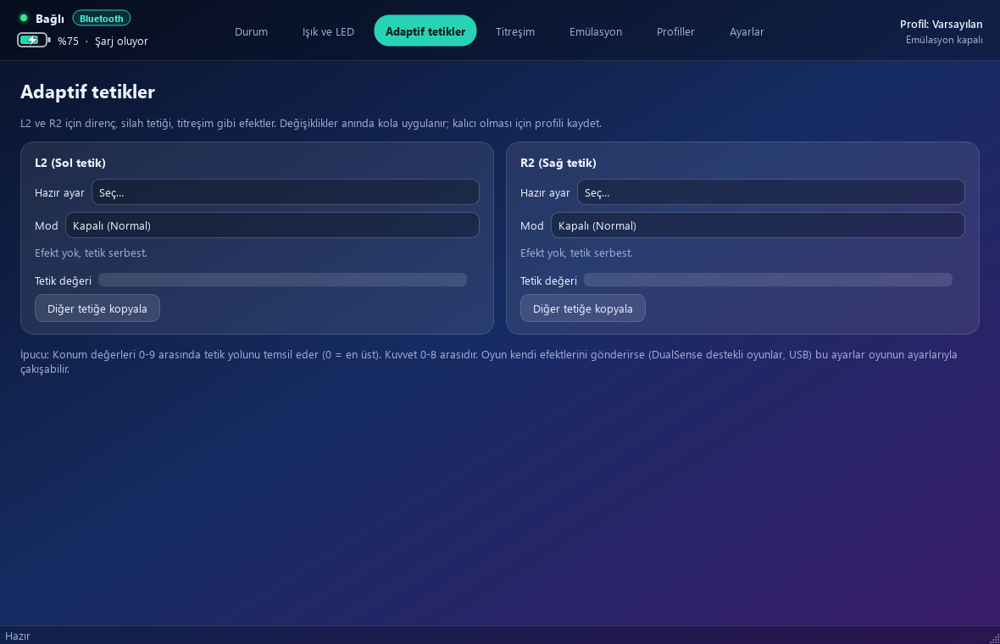
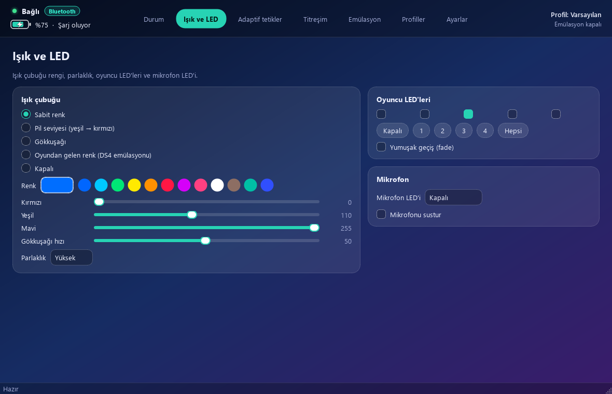
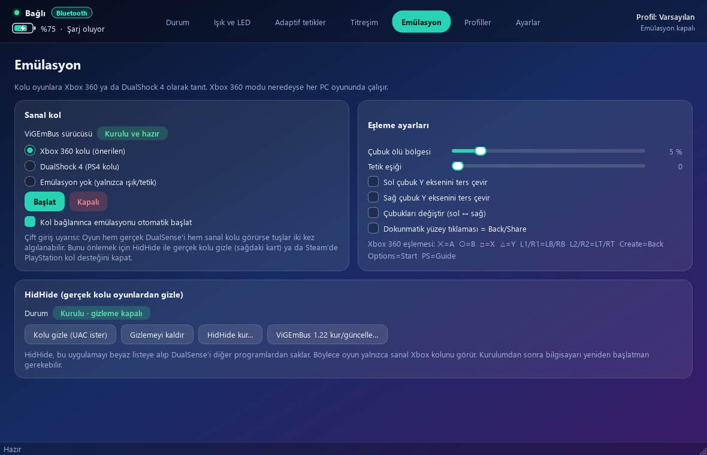

# DualSensePilot

PS5 DualSense kolunu Windows'ta özelleştirmek için DualSenseX / DSX benzeri, açık kaynak bir masaüstü uygulaması.
*(EN: open-source Windows app to customize the PS5 DualSense — adaptive triggers, lightbar, rumble, Xbox 360 / DS4 emulation, profiles. UI is Turkish.)*



## İndir ve kur

1. [**Releases**](../../releases/latest) sayfasından `DualSensePilot_Setup.exe` dosyasını indir.
2. Çalıştır. Sihirbaz sana **kurulum klasörünü seçtirir** (varsayılan `C:\Program Files\DualSensePilot`) ve sürücüler için yönetici izni ister.
3. Kurulum bitince uygulamayı başlat, kolu USB ile tak ya da Bluetooth ile eşleştir. Hepsi bu.

> Windows "Bilinmeyen yayıncı / SmartScreen" uyarısı gösterebilir: kurulum dosyası dijital olarak **imzalı değil** (kod imzalama sertifikası ücretli). Kaynak kodun tamamı bu depoda; aşağıdaki "Kurmadan önce incele" bölümünden neyi kurduğunu doğrulayabilirsin.

## Kurmadan önce incele

Kurulum bir şey yapmadan önce neyin yüklendiğini ve neden yönetici izni istediğini bilmek isteyebilirsin:

| Soru | Cevap |
|---|---|
| **Ne yüklenir?** | Uygulamanın kendisi ([PyInstaller](https://pyinstaller.org) ile paketlenmiş bu depodaki kod) + eksikse iki açık kaynak sürücü: **ViGEmBus** ve **HidHide** (aşağıya bak). |
| **Neden yönetici izni (UAC)?** | Yalnızca sürücü kurmak için. Sürücüler kernel seviyesinde çalışır, Windows bunu yönetici izni olmadan yapmaz. |
| **İnternet kullanır mı?** | **Hayır.** Kodda ağ bağlantısı yok (`import requests/urllib/socket` yok), telemetri yok, güncelleme denetimi yok. |
| **Ne okur/yazar?** | Kolla USB/Bluetooth HID üzerinden konuşur. Ayarlarını `%APPDATA%\DualSensePilot` altına yazar. Başka bir yere dokunmaz. |
| **Başka program çalıştırır mı?** | Yalnızca Windows'un `tasklist` komutunu (çalışan exe adlarını listelemek için, profil eklerken) ve — sen "Kolu gizle" düğmesine basarsan — HidHide'ın komut satırı aracını (yönetici izniyle). Oyuna özel profil için ön plandaki pencerenin exe **adına** bakar; hiçbir yere göndermez. |
| **Kaldırma** | Ayarlar → Uygulamalar → DualSensePilot. Sürücüler ayrı programlardır, istersen onları da oradan kaldırabilirsin. |

**Sürücüler (üçüncü taraf, açık kaynak):**

- [ViGEmBus](https://github.com/nefarius/ViGEmBus) (Nefarius) — oyunlara sanal Xbox 360 / DS4 kolu gösterir. Emülasyon için gerekli.
- [HidHide](https://github.com/nefarius/HidHide) (Nefarius) — gerçek kolu oyunlardan gizleyip çift girişi önler.

İkisinin kurulum dosyaları `tools/` klasöründe; ikisi de **Nefarius Software Solutions e.U. tarafından dijital olarak imzalı** (dosyaya sağ tık → Özellikler → Dijital İmzalar'dan doğrulayabilirsin). Bilgisayarında zaten kuruluysa yeniden kurulmaz. SHA-256:

```
F4BBBCB82E6258641B887C74BC81C4C5F66E4AA811808DFC304347687B7605F6  HidHide_1.5.230_x64.exe
89220A7865076B342892F98865F3499FB7C4CFD673159E89D352C360FD014C6A  ViGEmBus_1.22.0_x64_x86_arm64.exe
```

**Kurulum dosyasını doğrula:** indirdikten sonra PowerShell'de

```powershell
Get-FileHash .\DualSensePilot_Setup.exe -Algorithm SHA256
```

çıktısı release sayfasındaki SHA-256 ile aynı olmalı.

**Kendin derle (tercih edersen hiç hazır exe kullanma):** [Tek EXE üretmek](#tek-exe-üretmek) bölümüne bak; depoyu klonlayıp `kur.bat` ve `build.bat` çalıştırman yeterli.

## Ekran görüntüleri

| Adaptif tetikler | Işık ve LED | Emülasyon |
|---|---|---|
|  |  |  |

## Neler yapar?

| Özellik | Açıklama |
|---|---|
| **Adaptif tetikler** | L2/R2 için 14 efekt modu: direnç, silah tetiği, titreşim, yay, dörtnala, makine, bölgesel efektler ve ham bayt modu. Hazır ayarlar (tabanca, otomatik silah, gaz/fren pedalı…). |
| **Işık çubuğu** | Sabit renk, pil seviyesine göre renk, gökkuşağı, oyundan gelen renk (DS4 emülasyonu) ya da kapalı. 3 parlaklık kademesi. |
| **LED'ler** | 5 oyuncu LED'i tek tek, fade seçeneği; mikrofon LED'i (kapalı/açık/yanıp sönen) ve mikrofon susturma. |
| **Titreşim** | Motor testi, oyundan gelen titreşimi kola aktarma, şiddet ve alt eşik ayarı. Yeni yazılımlı kollarda gelişmiş titreşim otomatik. |
| **Emülasyon** | Kolu oyunlara **Xbox 360** ya da **DualShock 4** olarak tanıtır (ViGEmBus). Ölü bölge, eksen ters çevirme, çubuk değiştirme, tetik eşiği. |
| **HidHide** | Gerçek kolu oyunlardan gizleyip çift giriş sorununu önler (tek tıkla, UAC ister). |
| **Profiller** | Sınırsız profil; oyun exe'sine bağlayınca oyun öne geçtiğinde otomatik uygulanır. Sistem tepsisinden hızlı seçim. |
| **Durum** | Pil, şarj, yazılım sürümü, MAC, rapor hızı, canlı tuş/çubuk/tetik/jiroskop/dokunmatik yüzey görünümü. |

USB ve Bluetooth bağlantılarının ikisi de desteklenir (Bluetooth'ta CRC'li tam rapor modu kullanılır).

## Kaynaktan çalıştırma (geliştiriciler)

### 1. Uygulama

Bu klasörde zaten hazır bir sanal ortam (`.venv`) var. Doğrudan:

```
DualSensePilot.bat
```

Başka bir bilgisayara taşırsan ya da `.venv` yoksa önce `kur.bat` çalıştır (Python 3.10+ gerekir; yoksa `winget install Python.Python.3.12`).

### 2. Sürücüler (yönetici izni ister)

`tools\` klasöründe imzalı kurulum dosyaları hazır:

| Dosya | Ne için | Gerekli mi? |
|---|---|---|
| `ViGEmBus_1.22.0_x64_x86_arm64.exe` | Sanal Xbox 360 / DS4 kolu | Emülasyon için **evet** (bu bilgisayarda 1.17 zaten kurulu ve çalışıyor; 1.22 isteğe bağlı güncelleme) |
| `HidHide_1.5.230_x64.exe` | Gerçek kolu oyunlardan gizleme | Çift giriş sorunu yaşarsan |

Uygulamanın **Emülasyon** sayfasındaki butonlarla da başlatabilirsin. HidHide kurulumundan sonra yeniden başlatma gerekebilir.

## Kullanım

1. Kolu USB ile tak **ya da** Bluetooth ile eşleştir (Windows Ayarlar → Bluetooth → "DualSense Wireless Controller"). Kol kapalıysa PS tuşuna bas.
2. Uygulama kolu otomatik bulur; sol altta "Bağlı" yazar.
3. **Işık ve LED**, **Adaptif tetikler**, **Titreşim** sayfalarındaki her değişiklik anında kola gider.
4. Beğendiğin ayarları **Profiller → Mevcut ayarları kaydet** ile kaydet.
5. Oyun için: **Emülasyon → Xbox 360 → Başlat**. Oyun tuşları iki kez görürse **Kolu gizle (HidHide)**.
6. Oyuna özel profil: Profiller sayfasında profili seç → "Çalışan uygulamadan ekle" → oyunun exe'sini seç → "Ön plandaki uygulamaya göre profili otomatik değiştir" işaretle.

Kapatınca uygulama sistem tepsisinde çalışmaya devam eder (Ayarlar'dan değiştirilebilir). "Windows ile başlat" seçeneği de Ayarlar'da.

## Steam ile kullanım

Steam'in kendi DualSense desteği açıksa Steam oyunlarında tetik/ışık ayarları Steam tarafından ezilebilir. Steam → Ayarlar → Kumanda → "PlayStation kumanda desteği"ni kapat ve bu uygulamanın Xbox 360 emülasyonunu kullan.

## Tek EXE üretmek

```
build.bat
```

`dist\DualSensePilot\DualSensePilot.exe` oluşur (PyInstaller).

## Dosya yapısı

```
dsstudio/
  core/protocol.py   DualSense HID giriş/çıkış raporları (USB 0x01/0x02, BT 0x31 + CRC32)
  core/triggers.py   Adaptif tetik efekt üreteci (Nielk1 TriggerEffectGenerator Python portu, MIT)
  core/device.py     hidapi ile cihaz bulma, okuma iş parçacığı, yazılım/MAC bilgisi
  core/emulator.py   ViGEmBus (vgamepad) üzerinden X360/DS4 sanal kol + titreşim geri bildirimi
  core/service.py    Tüm parçaları birleştiren Qt servisi (16 ms çıkış, oto-profil)
  core/profiles.py   Profil/ayar JSON deposu  (%APPDATA%\DualSensePilot)
  core/hidhide.py    HidHide CLI entegrasyonu
  ui/                PySide6 arayüz (sayfalar, tema, bileşenler, tepsi)
tools/               ViGEmBus ve HidHide kurulum dosyaları
```

Günlük dosyası: `%APPDATA%\DualSensePilot\dsstudio.log`

## Sorun giderme

- **Kol görünmüyor:** PS tuşuna bas; Bluetooth'ta Windows "Bağlı" demeli. Başka bir uygulama (DS4Windows, DSX, Steam) kolu özel olarak açmış olabilir, onları kapat.
- **Tetik efekti çalışmıyor:** Bazı oyunlar (özellikle USB'de DualSense'i doğrudan destekleyenler) kendi efektlerini gönderir ve bu uygulamanınkini ezer. HidHide ile gizleyip Xbox emülasyonu kullan.
- **ViGEmBus bulunamadı:** `tools\ViGEmBus_1.22.0_x64_x86_arm64.exe` kur ve uygulamayı yeniden başlat.
- **Titreşim gelmiyor:** Titreşim yalnızca emülasyon açıkken oyundan gelir; "Oyundan gelen titreşimi kola aktar" işaretli olmalı.

## Kaynaklar

Linux `hid-playstation` sürücüsü, pydualsense, DS4Windows, Nielk1 TriggerEffectGenerator (MIT), Nefarius ViGEmBus / HidHide, vgamepad.
